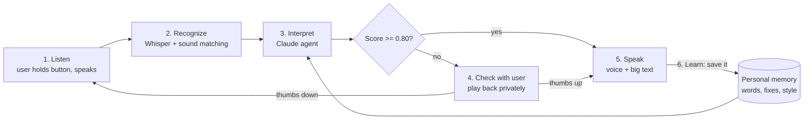

# Echo — Project Brief

Nov 6, 2026 · @Nergis

Echo is an agentic AI that learns how one person with cerebral palsy (CP) or dysarthria speaks, then translates their speech into clear words for the people around them. Built for Capital Hacks, in Turkish and English first.

## The problem

People with CP or dysarthric speech hear and understand the world around them, but the world around them does not understand them.

- **They know exactly what they want to say.** Their thinking, hearing and understanding are not the problem.
- **The barrier is physical expression.** They cannot fully control their tongue and mouth muscles, and many have breathing problems. Words come out slurred, broken by pauses, too fast or too slow.
- **Listeners give up.** Strangers, teachers, doctors and shop staff often ask them to repeat, guess wrong, or speak to a caregiver instead. The person is treated as if they don't understand, when they do.
- **Standard voice tech fails them.** Normal speech recognition is trained on typical speech. Error rates for dysarthric speech stay far higher than for typical speech, so Siri, Google and dictation apps mostly don't work.
- **Current workarounds are slow.** Tap-to-speak AAC apps and eye-gaze devices replace the person's own voice with tapping symbols or typing, which is slower than speaking and costs hundreds to thousands of dollars.

**In one sentence:** the problem is not in the person's mind or senses; it is the last step, turning a clear thought into sounds others can decode.

## The solution

Echo is a personal speech interpreter that lives on the user's phone. The user speaks in their own voice; Echo shows and speaks what they meant, clearly, to the person in front of them.

It is **agentic**, not just a speech-to-text model. An AI agent:

1. **Listens** to the user's speech and gets several possible transcripts from a speech recognizer.
2. **Reasons** about what the user most likely meant, using what it has learned about this person: their usual words and phrases, names of people and places in their life, how they build sentences, and the conversation so far.
3. **Outputs one sentence with a score.** Never a list to read.
4. **Speaks or checks.** Score 0.80 or higher: it speaks the sentence aloud and shows it in large text for the listener. Lower: it plays the sentence back to the user only, and the user answers with a thumbs up or thumbs down icon.
5. **Learns** from every thumbs up and every correction, so it gets better the more the user talks.

**What "learns the speech pattern and style" means:**

- **Speech pattern** = how their words *sound*: which sounds are hard for them, where breathing pauses fall, which words get shortened. Learned from their recordings.
- **Style** = how they *talk*: favourite words, their humour, how formal they are, phrases they repeat every day. Learned from approved sentences, so the output sounds like them, not like a robot.

**Core rule:** Echo translates; it never puts words in the user's mouth. Below the 0.80 threshold, nothing is spoken to the listener until the user gives a thumbs up.

## How the agent works



The agent only speaks when it is confident or the user has approved; every approval goes back into memory.

1. **Enrollment (once, about 5 minutes):** the user repeats about 20 everyday phrases after hearing them read aloud (no reading needed), plus names of family, friends and places. Each recording is saved with its correct text.
2. **Listen:** the user holds a big button and speaks.
3. **Recognize:** Whisper produces 2-3 candidate transcripts (with the user's personal words as a hint), and sound matching compares the audio to the user's past recordings.
4. **Interpret:** the Claude agent combines the candidates, the closest past sentences from memory, the user's style profile and the last few turns of conversation, then returns **one** sentence and a confidence score.
5. **Score and act:** Echo combines the signals into one score. 0.80 or higher → speak. Lower → play it back to the user only and wait for thumbs up or thumbs down.
6. **Learn:** the approved sentence, its audio and any correction are saved. The style profile is updated every few sentences.

## One output and the 0.80 threshold

The agent always produces exactly **one sentence**; it speaks it right away when its score is **0.80 or higher**, and checks with the user first when the score is lower. No step ever asks the user to read.

**Why one output:** many users have low literacy or can't read at all, so a list of written options is unusable. One sentence can be heard, and the user answers with an icon.

**How the score is made:** the LLM's own confidence is not reliable on its own, so Echo combines three signals (starting weights, tune with real data):

```
score = 0.5 * agent_confidence + 0.25 * candidate_agreement + 0.25 * sound_match_similarity
```

- Agent confidence: the 0-1 value Claude returns.
- Candidate agreement: how similar the 2-3 Whisper transcripts are to each other and to the final sentence (0-1).
- Sound-match similarity: cosine similarity to the closest past recording that had this meaning (0-1).

**What happens at each score:**

| Score | What Echo does |
| --- | --- |
| 0.80 or higher | Speaks the sentence to the listener and shows it in large text. A thumbs-down icon stays on screen for 5 seconds so the user can flag a mistake. |
| Below 0.80 | Plays the sentence back **to the user only** (low volume or earphones) with two big icons: thumbs up, thumbs down. Thumbs up → speak it aloud. Thumbs down → a spoken prompt "say it again" and a big repeat icon. |
| Below 0.80, second thumbs down | Stops guessing. Shows a "helper" icon so the listener or a caregiver can type what was meant; it is saved as a correction. |

**Why 0.80:** speaking a wrong sentence aloud puts words in the user's mouth, which is the worst failure, so the bar is high. But every check costs a person with dysarthria effort and breath, so a bar of 0.90 or more would trigger checks too often and tire them. 0.80 balances the two.

**Per-user tuning (after 30 spoken sentences):** if more than 5% of auto-spoken sentences get a thumbs-down, raise the threshold by 0.05; if more than 90% of checks get a thumbs-up, lower it by 0.05. Keep it between 0.70 and 0.90.

## Existing products and how we differ

Two products already translate atypical speech; neither learns the person's style, reasons with context, or supports Turkish.

| Product | What it does | Gap Echo fills |
| --- | --- | --- |
| [Voiceitt](https://voiceitt.com/?p=5511) | Personal speech model, speech-to-speech; needs 50 recordings first | Only knows trained phrases; no context or style; English-focused; about $200/year at launch |
| [Google Project Relate](https://www.freethink.com/?p=22871) | Listen, Repeat, Assistant on Android | 500 phrases to set up (30-90 min); English only, 4 countries |
| [Apple Listen for Atypical Speech](https://support.apple.com/en-jo/guide/mac-help/mchl5715a9f2) | Helps Siri understand atypical speech | Controls the device, does not translate for people nearby; US English only |
| AAC apps ([Proloquo2Go](https://apps.apple.com/us/app/-/id308368164), [Cboard](https://cboard.io/), Tobii Dynavox) | Tap symbols or use eye gaze to speak | Replaces the user's own voice; slow; devices are expensive |

**Our edge:** fast setup (about 20 phrases, then learns while used), an agent that uses context and personal memory instead of a fixed phrase list, output in the user's own style, and Turkish plus English from day one.

## Tech stack

A web app (works on a phone browser) talking to a Python backend that runs the speech models and the agent. Check the latest model names and SDK versions before installing.

| Layer | Choice | Why |
| --- | --- | --- |
| Frontend | Next.js + TypeScript + Tailwind CSS, installable as a PWA | One codebase for phone and laptop; mic access via the browser MediaRecorder API |
| Backend | Python + FastAPI | Speech and ML libraries are Python-first; simple REST endpoints |
| Speech recognition | Whisper large-v3 (hosted API for speed; faster-whisper locally as fallback) | Strong on both Turkish and English; accepts a prompt, so we can feed it the user's personal words |
| Personal sound matching | Audio embeddings from the user's enrollment recordings + cosine similarity | Lets us recognise "this sounds like the user's way of saying X" even when Whisper fails |
| Agent brain | Claude (Anthropic API, Sonnet model) with tool use | Reasons over transcripts, memory and context; calls tools to search memory and save corrections |
| Memory database | MongoDB Atlas + Atlas Vector Search | Stores users, recordings, phrasebook, corrections and style profile; vector search finds similar past sentences |
| Text embeddings | A multilingual text embedding model | Matches Turkish and English sentences by meaning |
| Text-to-speech | ElevenLabs multilingual voices; browser Web Speech API as fallback | Natural Turkish and English; optional voice made from the user's own samples, with consent |
| Audio storage | Local `uploads/` folder for MVP, S3-compatible storage later | Keep the hackathon build simple |
| Hosting | Vercel (frontend), Render or Railway (backend) | Free tiers, fast deploys for the demo |

**Environment variables:** `ANTHROPIC_API_KEY`, `OPENAI_API_KEY` or `GROQ_API_KEY` (Whisper), `ELEVENLABS_API_KEY`, `MONGODB_URI`, `EMBEDDING_API_KEY`.

## Languages

Echo launches in **Turkish and English**, and is designed so more languages can be added without rebuilding it.

- The user picks a main language at signup; the recognizer can also auto-detect each utterance.
- Enrollment phrase lists exist in both languages (`phrases/tr.json`, `phrases/en.json`).
- The agent replies in the language the user spoke, and keeps code-switching (mixing Turkish and English) when the user does.
- **Roadmap:** more languages are planned (for example Arabic, Spanish, German). Adding one means adding a phrase list, UI translations and a TTS voice; Whisper and Claude already handle many languages.

## Scope, principles and privacy

**MVP (must work at the demo):**

- Enrollment: user repeats about 20 personal phrases.
- Conversation mode: hold a button, speak, and the listener hears and sees the clear sentence.
- Agent picks one meaning using transcripts, sound matching and memory, plus a score.
- Thumbs up / thumbs down check below 0.80; every approval and fix is saved and used next time.
- Turkish and English.

**Stretch goals:**

- Voice output in the user's own cloned voice.
- Caregiver view to add names, places and phrases for the user.
- Fine-tuning a personal Whisper model (LoRA) on the user's recordings.
- Phone-call mode and quick-phrase shortcuts.

**Principles:**

- The user is always in control: nothing is spoken that they did not approve (at 0.80 or higher Echo speaks right away; below that, the user approves first with a thumbs up).
- Big buttons and hold-to-talk, since many users have limited hand control.
- No reading required: every choice is an icon or a sound, never a written option.
- Translate, don't rewrite: keep the user's words and style, only make them clear.

**Privacy:** voice recordings are health-adjacent data. Get clear consent at signup, store recordings per user only, let the user delete everything with one button, and never use one user's voice to train for another without opt-in.

## Sources

- [Voiceitt](https://voiceitt.com/?p=5511) · [Project Relate (Freethink)](https://www.freethink.com/?p=22871) · [Apple Siri accessibility](https://support.apple.com/en-jo/guide/mac-help/mchl5715a9f2) · [Proloquo2Go](https://apps.apple.com/us/app/-/id308368164) · [Cboard](https://cboard.io/)